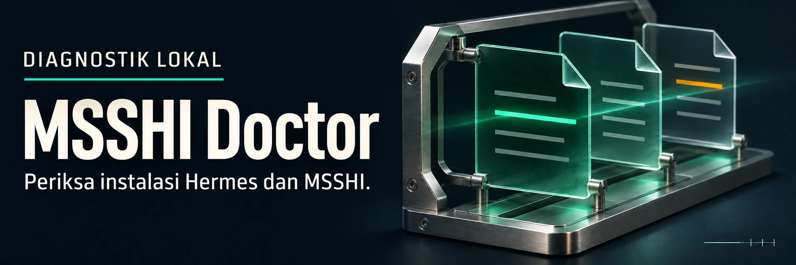
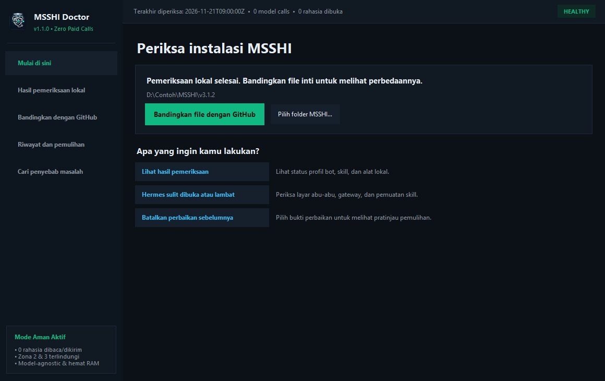
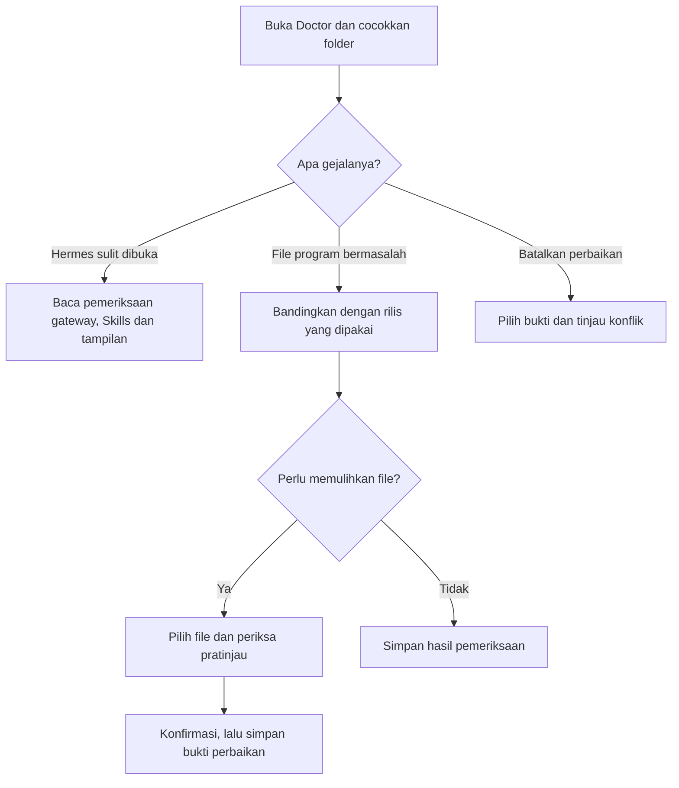
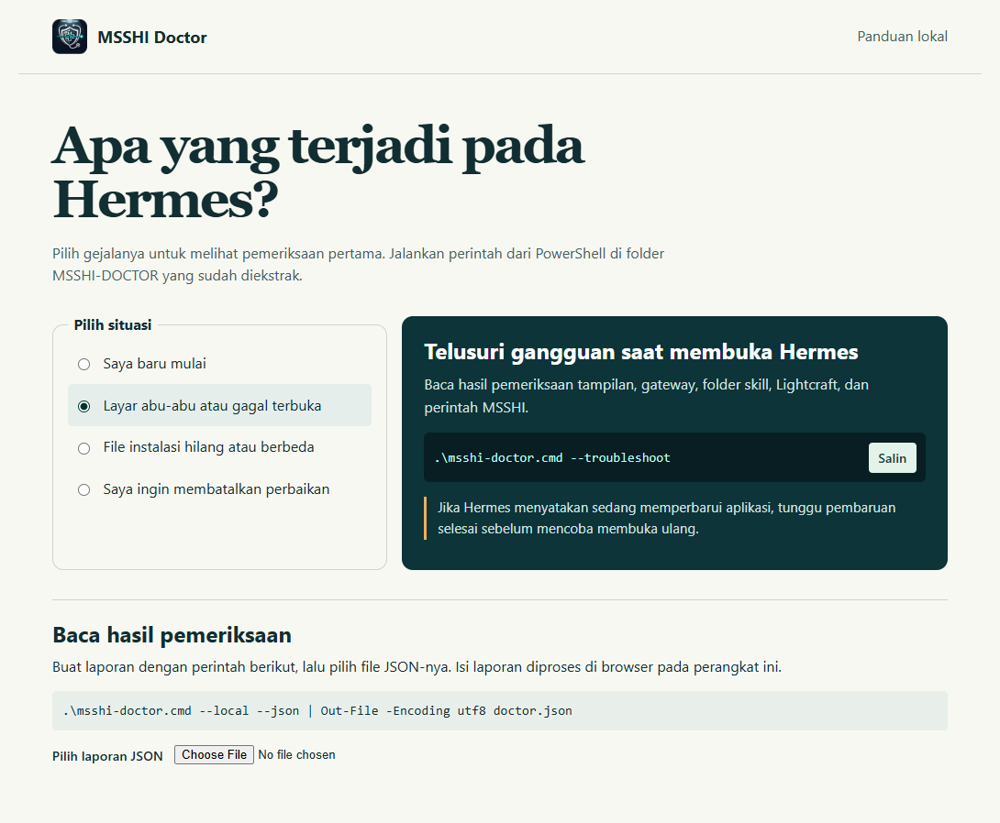

<p align="center"></p>

#  MSSHI Doctor

Hermes menampilkan layar abu-abu? Panel Skills macet? Ada file MSSHI yang terhapus? **Mulai dengan pemeriksaan lokal.** Doctor menunjukkan lokasi yang diperiksa, membandingkan file program dengan rilis resmi yang kamu pilih, dan menyediakan cadangan untuk perbaikan file online. Pemeriksaan ini berjalan tanpa chat atau kredit model.

**Versi aplikasi Doctor 1.2.0** · **Panduan untuk MSSHI v3.2.0** · [Lihat rilis MSSHI yang dijadikan pembanding](https://github.com/zidanaisar624/MSSHI-Mega-Semar-Sang-Hyang-Ismaya)

[](https://saweria.co/muzas)

## Mulai di Windows

| Yang kamu punya | Cara membuka |
| --- | --- |
| Paket portabel Windows x64 | Ekstrak seluruh isi ZIP ke satu folder, lalu buka **MSSHI-Doctor.exe**. Python, Node.js, dan Rust sudah tidak diperlukan di komputer pengguna paket ini. Paket hasil build tersedia pada run yang berhasil di [GitHub Actions](https://github.com/zidanaisar624/MSSHI-DOCTOR/actions/workflows/check.yml). Mengunduh artifact dari Actions memerlukan akun GitHub yang sudah masuk. |
| Python 3.10 atau lebih baru dengan Tk | [Unduh ZIP kode sumber](https://github.com/zidanaisar624/MSSHI-DOCTOR/archive/refs/heads/main.zip), pilih **Extract All**, buka folder yang berisi README ini, lalu klik dua kali **MSSHI_Doctor.bat**. |
| Ingin membaca dulu | Setelah mengekstrak paket, buka **docs → panduan → index.html** di browser. Pilih gejala untuk melihat perintahnya. Panduan dapat dibuka tanpa internet. |

Jika kamu mengunduh dari Actions, buka hasil pemeriksaan bertanda centang, pilih **Artifacts → MSSHI-Doctor-Windows-x64**, lalu ekstrak juga ZIP versi di dalamnya. Letakkan `_internal` di sebelah `MSSHI-Doctor.exe`. Jika jendela gagal muncul, buka PowerShell di folder tersebut dan jalankan `.\msshi-preflight.exe`. Hasilnya menunjukkan komponen paket yang perlu diekstrak kembali.

1. Di layar **Mulai di sini**, periksa alamat instalasi MSSHI. Jika keliru, klik **Pilih folder MSSHI…**. Pilih folder program yang berisi antara lain `VERSION.json` dan `scripts/msshi_cli.py`.
2. Jika Hermes sulit dibuka, pilih **Hermes sulit dibuka atau lambat**. Jika kamu mencurigai ada file program yang hilang, pilih **Bandingkan file dengan GitHub**.
3. Untuk instalasi yang mengikuti tag tetap, pilih **v3.2.0** (atau **v3.1.2** sesuai versi lokalmu). Gunakan **main** bila instalasimu memang mengikuti pembaruan di cabang itu. File dari `main` yang lebih baru bisa berbeda dari tag meski nomor versi di laptop masih sama.
4. Baca hasilnya. Bila file perlu dikembalikan, pilih file, klik **Preview & Perbaiki Terpilih**, lalu cocokkan nama file dan commit sumber. Klik **Jalankan Perbaikan Aman** setelah kamu setuju. Simpan ID bukti perbaikan (*receipt*) agar perubahan bisa ditelusuri.



## Pilih sesuai gejala

| Yang kamu lihat | Pemeriksaan pertama | Cara membaca hasil |
| --- | --- | --- |
| Layar kosong, gateway terlambat menjawab, atau Skills lambat | **Hermes sulit dibuka atau lambat** | Baca temuan tentang tampilan, gateway, folder skill, Lightcraft, dan perintah MSSHI. Jalankan saran yang cocok dengan gejala yang ditemukan. |
| Folder instalasi belum ditemukan | **Pilih folder MSSHI…** | Cocokkan lokasi instalasi. Folder aplikasi Doctor dan folder data profil Hermes punya fungsi berbeda. |
| File hilang atau rusak (`MISSING`, `CORRUPTED`) | **Bandingkan file dengan GitHub** | Periksa daftar dan versi sumber. Pilih hanya file yang perlu dipulihkan. |
| File berbeda (`DRIFTED`) | Tinjau pilihan sebelum memperbaiki | Perubahan lokalmu atau pembaruan di cabang lain bisa sah. Doctor membiarkan file berbeda ini tidak tercentang saat daftar pertama ditampilkan. |
| GitHub tidak terjangkau atau kuota permintaan habis | Baca pemeriksaan lokal, lalu ulangi perbandingan ketika koneksi tersedia | Perbandingan lokal atau cache belum membuktikan kondisi rilis di GitHub saat ini. Tunggu verifikasi sumber sebelum menerapkan perbaikan online. |
| Ingin membatalkan perbaikan sebelumnya | **Batalkan perbaikan sebelumnya** | Pilih bukti `online-repair`, periksa pratinjau pemulihan, lalu konfirmasi. Jika file berubah lagi setelah perbaikan, baca konflik sebelum melanjutkan. |



## Panduan interaktif dan laporan



Buka [panduan interaktif](docs/panduan/index.html) **dari folder hasil ekstraksi**. GitHub menampilkan kode HTML bila dibuka dari halaman repositori. Untuk membaca hasil pemeriksaan dalam bahasa Indonesia, jalankan dari PowerShell di folder Doctor:

```powershell
.\msshi-doctor.cmd --local --json | Out-File -Encoding utf8 doctor.json
```

Klik **Pilih laporan JSON** di panduan dan pilih `doctor.json`. Panduan meringkas laporan `--local` atau `--online` di perangkatmu. File laporan lengkap dapat memuat lokasi folder di laptop, jadi periksa isinya sebelum membagikannya.

## Perintah PowerShell

Jalankan dari folder yang berisi `msshi-doctor.cmd`. Perbandingan online memerlukan internet dan membaca repositori MSSHI publik. Pemeriksaan lokal dan pratinjau membantu menentukan apakah ada yang perlu diubah.

| Keperluan | Perintah |
| --- | --- |
| Cek versi Doctor | `.\msshi-doctor.cmd --version` |
| Cek pembaruan aplikasi Doctor (`MSSHI-DOCTOR`) | `.\msshi-doctor.cmd --check-app-update` |
| Pratinjau self-update aman Doctor | `.\msshi-doctor.cmd --self-update --dry-run` |
| Lihat instalasi dan profil | `.\msshi-doctor.cmd --local` |
| Periksa metadata tanpa memanggil CLI MSSHI | `.\msshi-doctor.cmd --local --skip-cli` |
| Telusuri masalah saat membuka Hermes | `.\msshi-doctor.cmd --troubleshoot` |
| Bandingkan file inti dengan tag v3.2.0 | `.\msshi-doctor.cmd --online --ref v3.2.0` |
| Pratinjau pemulihan satu file | `.\msshi-doctor.cmd --online-fix --dry-run --ref v3.2.0 --files VERSION.json` |
| Daftar bukti perbaikan | `.\msshi-doctor.cmd --receipts` |
| Lihat seluruh opsi | `.\msshi-doctor.cmd --help` |

**Contoh pemulihan.** Jika pratinjau menunjukkan bahwa `VERSION.json` memang perlu dikembalikan, terapkan pilihan itu dengan perintah berikut. Untuk instalasi di folder khusus, sertakan `--target-root` dengan jalur yang sama pada pemeriksaan, pratinjau, dan penerapan. Opsi `--hermes-home` dan `--msshi-home` tersedia untuk memilih folder profil dan peluncur secara eksplisit.

```powershell
.\msshi-doctor.cmd --online-fix --apply --ref v3.2.0 --files VERSION.json
```

Pada CLI, pertahankan `--files` untuk membatasi perbaikan ke pilihanmu. Jika daftar itu dihilangkan, semua perbedaan inti yang memenuhi syarat dapat ikut dipulihkan.

**Untuk membatalkannya**, salin ID dari `--receipts` dan jalankan pratinjau berikut. Gunakan `--apply` sebagai pengganti `--dry-run` setelah hasil dan targetnya sesuai.

```powershell
$id = Read-Host "ID bukti perbaikan"
.\msshi-doctor.cmd --rollback $id --dry-run
```

Untuk otomatisasi, tambahkan `--json`. Kode keluar **0** berarti pemeriksaan tersebut selesai tanpa temuan yang memerlukan tindakan, **1** berarti ada kegagalan inti, dan **2** berarti hasil perlu ditinjau. Periksa pesan atau kolom `status` dan `connection_status` untuk mengetahui penyebabnya.

## File apa yang bisa berubah?

Perbaikan online memulihkan **file inti yang kamu pilih** dari repo resmi MSSHI. Doctor mengikat unduhan ke commit GitHub, memverifikasi isi file, dan mencatat cadangan di area runtime untuk pemulihan. Profil seperti `SOUL.md`, pengaturan provider, model, endpoint, base URL, dan kunci API berada di luar cakupan penggantian file program. Status keberadaan profil, alat, dan konfigurasi ditampilkan terpisah dari bukti uji eksekusi. Hasil pemeriksaan lokal tidak memastikan sebuah model berbayar dapat menjawab chat.

## Untuk pengembang

Antarmuka desktop dan mesin perbaikan menggunakan Python/Tk. Panduan menggunakan JavaScript lokal. Untuk membuka Doctor dari kode sumber di lingkungan Python aktif, jalankan `python -m pip install .`, lalu `msshi-doctor --local` atau `msshi-doctor --gui` jika Tk tersedia. Pemeriksa awal Rust opsional memeriksa kesiapan peluncur pada instalasi sumber. Untuk menjalankannya dari checkout:

```powershell
cargo run --quiet --offline --manifest-path tools/preflight/Cargo.toml -- --doctor-dir .
```

Jalankan pengujian dari akar repositori:

```powershell
$env:PYTHONPATH = "src"
python -B -m unittest discover -s tests -v
node --test tests/guide.test.cjs
cargo test --locked --offline --manifest-path tools/preflight/Cargo.toml
```

## Dukung Pengembangan / Support

[](https://saweria.co/muzas)

Proyek inti **MSSHI Doctor** tetap **open-source** dan bebas digunakan oleh siapa saja. Jika bermanfaat, dukungan sukarela melalui [Saweria (`https://saweria.co/muzas`)](https://saweria.co/muzas) membantu kelanjutan riset, pengujian, serta pembaruan rutin aplikasi ini.

---

[Alur build Windows](.github/workflows/check.yml) · [Ilustrasi Doctor di aplikasi](assets/msshi-doctor-banner.jpg) · [Laporan implementasi awal v1.0 (PDF)](docs/reports/Laporan_Implementasi_MSSHI_Doctor_App.pdf) · [Lisensi MIT](LICENSE)
